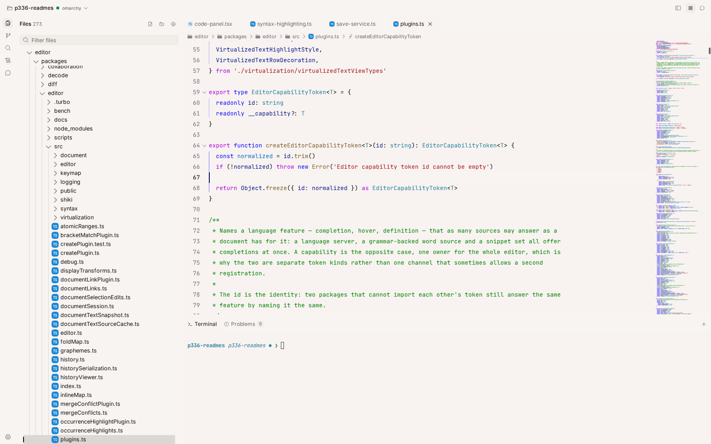

# Fregat

Fregat is a browser IDE with an editor, terminals, Git, language servers, and your Claude Code and Codex agents.



## Run from source

```sh
git clone https://github.com/ShaulLavo/fregat.git
cd fregat
bun install --frozen-lockfile
bun run build:workspaces
bun run dev
```

Open the URL printed by the dev server and pick a folder.
Use Bun 1.4.4, Node.js 26 or newer, Git, and a recent browser.

## Links

- [Website](https://fregat.shaulavo.dev/)
- [Overview and requirements](docs/project-overview.md)
- [Development and checks](docs/development.md)
- [Documentation](docs/README.md)
- [Contributing](CONTRIBUTING.md)
- [Discussions](https://github.com/ShaulLavo/fregat/discussions)
- [MIT license](LICENSE)
