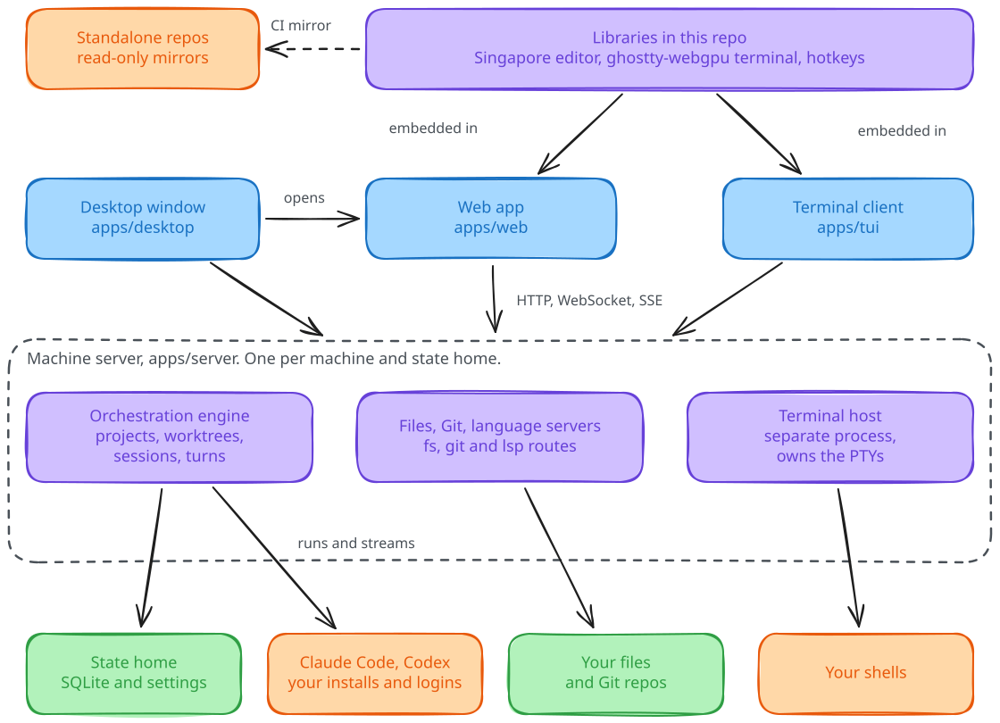
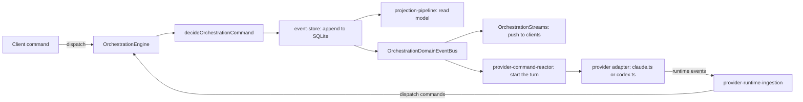

# Architecture

Fregat is a server plus several clients on one machine. The server owns your files, Git, terminals, language servers and agent sessions. The clients show them. This page explains why the pieces sit where they do. For a folder-by-folder list, see the [monorepo map](monorepo.md).

<picture>
  <source media="(prefers-color-scheme: dark)" srcset="assets/architecture.dark.svg">
  
</picture>

Every client talks to the same server, and the libraries below it are shared. The dashed arrow marks the one copy the repository makes for outsiders.

## One server per machine

A machine runs one server for each state home. The default state home is `~/.platform`, and `bun run dev` uses `~/.platform-dev` so development never touches your real data. Browser tabs, the desktop window, the terminal client and a paired phone all connect to that one server, so they see the same sessions and terminals. Closing a client leaves the server and its terminals running. [ADR 003](adr/003-one-server-per-machine-shared-by-clients.md) records why.

The server is `apps/server`, built on Bun and Elysia. Clients call it through typed HTTP routes (the web app and `packages/client-core` use the Eden client), WebSockets for terminals, language servers and orchestration streams, and server-sent events. The shared types and schemas live in `packages/contracts`, so a route change fails the build in every client that uses it.

## Side effects stay on the server

Anything that touches the machine runs in the server: file reads and writes, Git, file watching, language servers, terminals, agent processes and the SQLite database. The clients keep view state and product workflows. This is why the same terminal and agent work shows up in every client, and why `apps/web` never opens a file itself. The [filesystem boundaries](filesystem-boundaries.md) page covers what the file routes can reach.

## How an agent turn flows

Sessions belong to worktrees, and worktrees belong to projects. The server records every change to that state as an event, and clients subscribe to the events they need. The sequence below uses the real file and symbol names in `apps/server/src/orchestration/`.

Read the loop from the right: the adapter turns agent output into runtime events, `provider-runtime-ingestion` turns those into commands, and the engine turns commands into events that every client receives. The [session domain](session-domain.md) page describes identity, recovery and deletion rules.

## Terminals outlive the server

Shells run in a separate terminal host process, not in the server. When the server restarts, the next server adopts the host's leases and replays each shell's output from its saved byte offset. The behavior is verified on Linux. On macOS the host runs as a detached process and the restart check is still open. [Terminal host](terminal-host.md) has the protocol and limits.

## Libraries and mirrors

Three folders in this repository are products of their own: `editor/` (Singapore, the editor), `ghostty-webgpu/` (Ghostty's terminal in the browser) and `hotkeys/` (the keymap library). The web app embeds all three. The terminal client uses the editor's core and the keymap library. On every push to `main`, CI copies each folder to a read-only repository. [ADR 001](adr/001-one-repository-with-mirrors.md) explains the choice.

## Platform support

The landing page lists Linux and macOS and does not list Windows. On Linux the desktop window prefers the installed Chrome app, and on macOS it uses a native WebKit window. See the [status section](../README.md#status) for the current limits.
