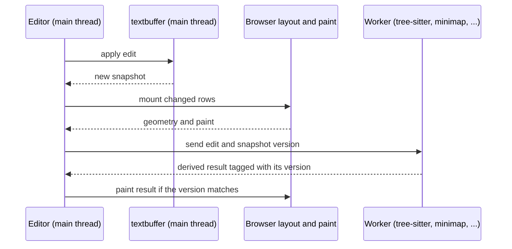

# Architecture

Singapore has one source of truth for text, and everything else is a view of it or work derived from it. This page explains how the pieces fit and why. The [design documents](docs/README.md) hold the detail, and the [ADRs](docs/adr/) record the decisions.

## The idea

The canonical document is a persistent piece table that lives on the main thread. Each edit returns a new snapshot, and old snapshots stay valid. The visible text, the syntax colors, the folds and the minimap are projections of one snapshot. Each projection says which snapshot it describes, so a worker that lags behind typing cannot pass off an old answer as current.

The goals that shape the rest:

- A keystroke reaches the screen within one display frame. Typing never waits for derived work.
- Large files work. Only rows near the viewport are in the DOM.
- The browser does the text layout. The editor does not keep a second layout engine.
- The core is plain text editing. Everything else is an optional package.

## Layers

The [README](README.md) has a package diagram. This table maps each layer to its packages and its design document.

| Layer          | Package                                                                | What it owns                                                                  | Design document                                                                                                    |
| -------------- | ---------------------------------------------------------------------- | ----------------------------------------------------------------------------- | ------------------------------------------------------------------------------------------------------------------ |
| Storage        | `textbuffer`                                                           | Piece table, snapshots, anchors, line mapping                                 | [Piece table](docs/storage/piece-table.md)                                                                         |
| Positions      | `textbuffer`, `core`                                                   | Offset, point, and anchor types and conversions                               | [Types and conversions](docs/positions/types-and-conversions.md), [Anchors](docs/positions/anchors.md)             |
| Editing        | `core`                                                                 | Selections, multi-cursor, batch edits, undo                                   | [Selections and undo](docs/editing/selections-and-undo.md)                                                         |
| Display        | `core`                                                                 | Row virtualization, folds, browser-owned geometry, CSS Custom Highlight paint | [Browser layout and virtualizer](docs/display/browser-virtualization.md), [Transforms](docs/display/transforms.md) |
| Syntax         | `tree-sitter`, `highlighting`                                          | Parsing, highlight queries, folds, structural selection, injections           | [Tree-sitter](docs/syntax/tree-sitter.md)                                                                          |
| Workers        | `tree-sitter`, `minimap`, `spellcheck`, `typescript-lsp`, `core/shiki` | One owner object per worker: start, requests, disposal                        | [Worker topology](docs/architecture/worker-topology.md)                                                            |
| Extension host | `core/extensions`                                                      | Plugin lifecycle and the contribution registries                              | [Extension hooks](docs/architecture/extension-hooks.md)                                                            |

## What happens when you type

One keystroke, in order. Notice that the editor paints the edit before any worker answers.

Derived work has to describe the current snapshot, or be projected through the edits that followed it. Sending the version with each request is what lets the editor tell the difference.

## Main thread and workers

The main thread owns the document, selections, undo, row mounting and paint. Workers own derived state:

| Work                              | Owner object               | Package          |
| --------------------------------- | -------------------------- | ---------------- |
| Tree-sitter parsing and queries   | `TreeSitterWorkerClient`   | `tree-sitter`    |
| Minimap drawing (OffscreenCanvas) | `MinimapWorkerOwner`       | `minimap`        |
| Shiki tokenizing                  | `ShikiWorkerOwner`         | `core/shiki`     |
| TypeScript language service       | `TypeScriptLspWorkerOwner` | `typescript-lsp` |

`core/shiki` is the `@singapore-editor/core/shiki` entry point inside the `core` package, not a separate package. See the [Shiki entry point](packages/editor/README.md#shiki-entry-point).

Each owner starts its worker, tracks requests, and disposes it. The plugin or service that creates an owner disposes it at teardown, and the package-level worker singletons are gone. [Worker topology](docs/architecture/worker-topology.md) lists each owner's cache limits and what happens after a crash. [ADR 003](docs/adr/003-document-on-main-thread.md) explains why the document stays on the main thread.

## Plugins

A plugin is an object with `activate` and optional `install`, `update`, `deactivate`, and `dispose` hooks. Each editor gets its own install of a plugin and its own context. Whatever a plugin registers through that context is released when the plugin goes. Plugins reach the editor through typed registries (commands, decorations, gutters, language features) exported from `@singapore-editor/core/extensions`, not through a general editor object. A view contribution is the escape hatch for features that need mounted DOM or viewport snapshots. [Extension hooks](docs/architecture/extension-hooks.md) maps every hook, its scope and ordering.

## Open design questions

- **Document worker.** No separate worker owns the document. The main-thread engine stays the truth until that work lands.
- **Row heights.** Rows have a fixed height today. Variable-height rows and complete horizontal handling of long lines are in progress. See [Known limits](docs/limitations.md).
- **Plugin surface.** A few first-party features, such as `mergeConflictPlugin.ts`, still register through the internal `registerEditorFeatureContribution` bridge. Moving them to the public registries and deleting the bridge is unfinished.
