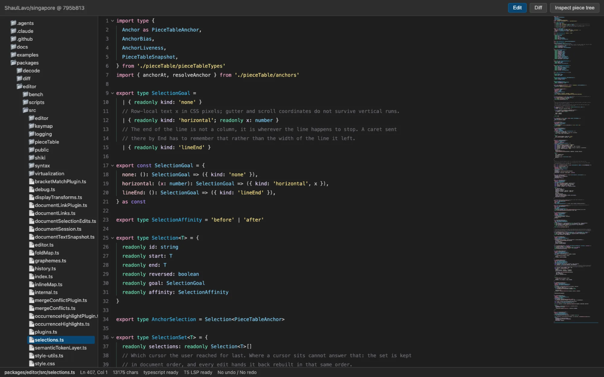

<h1 align="center">Singapore</h1>
<p align="center">A code editor for the browser that keeps every version.</p>
<p align="center">
  <a href="https://github.com/ShaulLavo/fregat/actions/workflows/workspace-libraries.yml"></a>
  <a href="LICENSE"></a>
</p>
<p align="center">
  <a href="https://singapore.shaulavo.dev/">Website and demo</a> ·
  <a href="https://singapore.shaulavo.dev/docs/start-here/introduction/">Docs</a> ·
  <a href="docs/performance/browser-compare-2026-10-08.md">Benchmarks</a> ·
  <a href="https://github.com/ShaulLavo/fregat/discussions">Discussions</a>
</p>

<p align="center"></p>

Every edit returns a new version of the text. Old versions stay readable and share their unchanged storage:

```ts
import {
  createPieceTableSnapshot,
  insertIntoPieceTable,
  materializePieceTableFullText,
} from '@singapore-editor/textbuffer'

const original = createPieceTableSnapshot('hello')
const edited = insertIntoPieceTable(original, 5, ' world')
const branch = insertIntoPieceTable(original, 0, 'say ')

materializePieceTableFullText(original) // 'hello'
materializePieceTableFullText(edited) // 'hello world'
materializePieceTableFullText(branch) // 'say hello'
```

That buffer is the base of a browser editor. You can keep an old snapshot readable while the user edits the current document, and positions called anchors follow the text through every edit.

- **Versions are cheap to keep.** A persistent piece table copies only the tree nodes on the path an edit changes. [Text storage](docs/storage/piece-table.md) explains the tree and snapshots.
- **Positions survive edits.** An anchor points into immutable storage and resolves against any snapshot. Read the [anchor rules](docs/positions/anchors.md).
- **The browser lays out the text.** Singapore mounts the visible rows as DOM and paints syntax colors with the CSS Custom Highlight API. It has no second text-layout engine. [Browser behavior](docs/display/browser-quirks.md) records the engine bugs it works around.
- **Workers do the derived work.** Tree-sitter, the minimap, spellcheck and the TypeScript language service run in workers. The main thread keeps the document.
- **The core stays small.** `new Editor(element)` and `setText(text)` give you an editor. Gutters, search, syntax, language servers and the rest are separate packages.

<picture>
  <source media="(prefers-color-scheme: dark)" srcset="docs/assets/singapore-overview.dark.svg">
  
</picture>

The core reads text from `textbuffer`, sends edits to workers, and gets plugins from the feature packages. Only the feature packages talk to servers and peers.

## Quick start

1. Install the core and a bundler. This example uses Vite.

   ```sh
   npm install @singapore-editor/core vite
   ```

2. Save this as `index.html`. The height and flex column limit the editor's scroll area to the container.

   ```html
   <div id="editor" style="height: 20rem; display: flex; flex-direction: column"></div>
   <script type="module" src="/main.ts"></script>
   ```

3. Save this as `main.ts`.

   ```ts
   import { Editor } from '@singapore-editor/core/editor'
   import '@singapore-editor/core/style.css'

   const element = document.querySelector<HTMLElement>('#editor')!
   const editor = new Editor(element)
   editor.setText('const greeting = "Hello, Singapore"\n')
   // Call editor.dispose() when you remove the editor.
   ```

4. Run `npx vite` and open the printed address. You see one line of text, `const greeting = "Hello, Singapore"`. You can move the caret, select and type.

The npm packages are older than this source. See [Status](#status). To run the demo app from source, clone Fregat and use Bun 1.4.4 (pinned in `packageManager`) with Node.js 26 or newer:

```sh
git clone https://github.com/ShaulLavo/fregat.git
cd fregat
bun install --frozen-lockfile
bun x turbo run build --filter='./editor/packages/*'
bun run --cwd editor/examples/app dev
```

Vite prints the address of the demo app.

## Packages

Each package has a short README with install, usage and API notes. The [generated API reference](https://singapore.shaulavo.dev/docs/reference/packages/) covers every export.

| Group            | Package                                                                  | Adds                                                                          |
| ---------------- | ------------------------------------------------------------------------ | ----------------------------------------------------------------------------- |
| Core             | [`core`](packages/editor/README.md)                                      | The editor: text editing, selections, undo history, themes, and plugins       |
|                  | [`textbuffer`](packages/textbuffer/README.md)                            | Persistent piece-table buffer with snapshots, anchors, and line mapping       |
| Syntax           | [`highlighting`](packages/highlighting/README.md)                        | Worker-based syntax highlighting for editors, diffs, and code snippets        |
|                  | [`tree-sitter`](packages/tree-sitter/README.md)                          | Worker-based parsing for syntax colors, folds, and brackets                   |
|                  | [`tree-sitter-languages`](packages/tree-sitter-languages/README.md)      | Grammars and queries for the language plugins                                 |
| Language servers | [`lsp`](packages/lsp/README.md)                                          | Language Server Protocol client with WebSocket and worker transports          |
|                  | [`lsp-plugin`](packages/lsp-plugin/README.md)                            | Diagnostics, completion, hover, and navigation                                |
|                  | [`typescript-lsp`](packages/typescript-lsp/README.md)                    | TypeScript and JavaScript language services in a browser worker               |
| Editor features  | [`gutters`](packages/gutters/README.md)                                  | Line numbers and fold controls                                                |
|                  | [`find`](packages/find/README.md)                                        | Find and replace with regular expressions                                     |
|                  | [`minimap`](packages/minimap/README.md)                                  | Worker-rendered file overview with scroll controls                            |
|                  | [`scope-lines`](packages/scope-lines/README.md)                          | Indent guides, sticky headers, and bracket pair colors                        |
|                  | [`spellcheck`](packages/spellcheck/README.md)                            | Worker-based English spellchecking                                            |
|                  | [`markdown`](packages/markdown/README.md)                                | Markdown preview and editing commands                                         |
|                  | [`diff`](packages/diff/README.md)                                        | Stacked and split diffs with inline changes                                   |
|                  | [`file-animation`](packages/file-animation/README.md)                    | Text reveal animations for opened documents                                   |
|                  | [`plugin-ui`](packages/plugin-ui/README.md)                              | Shared hover tooltips and anchored popups for plugins                         |
| Large files      | [`paged`](packages/paged/README.md)                                      | Read-only UTF-8 viewer model with byte-range loading and a bounded page cache |
| Collaboration    | [`collab`](packages/collab/README.md)                                    | Host-ordered editing with persistent snapshots and character identities       |
|                  | [`collaboration`](packages/collaboration/README.md)                      | Session protocols, transports, and remote cursor presence                     |
| Layout           | [`panes`](packages/panes/README.md)                                      | Resizable split panes for DOM elements                                        |
| Frameworks       | [`react`](packages/react/README.md), [`solid`](packages/solid/README.md) | Components, hooks, and reactive controls                                      |

All packages use the `@singapore-editor/` scope. The folder `packages/editor` publishes as `@singapore-editor/core`.

Other folders: [`examples/app`](examples/app) is the demo app, [`examples/stress`](examples/stress/README.md) is the stress and latency harness, [`bench/compare`](bench/compare/README.md) runs the browser comparison below, and [`site`](site/README.md) builds the documentation site.

## What you can do

| Task                                   | Guide                                                                                                                                      |
| -------------------------------------- | ------------------------------------------------------------------------------------------------------------------------------------------ |
| Mount an editor in React or Solid      | [React and Solid](https://singapore.shaulavo.dev/docs/guides/frameworks/)                                                                  |
| Add syntax colors                      | [Languages and tree-sitter](https://singapore.shaulavo.dev/docs/guides/languages/)                                                         |
| Connect a language server              | [Language servers](https://singapore.shaulavo.dev/docs/guides/lsp/)                                                                        |
| Open a very large file                 | [Large files](https://singapore.shaulavo.dev/docs/guides/large-files/)                                                                     |
| Write a plugin                         | [Plugins](https://singapore.shaulavo.dev/docs/guides/plugins/)                                                                             |
| Change colors and fonts                | [Themes](https://singapore.shaulavo.dev/docs/guides/themes/)                                                                               |
| Host the workers in a production build | [Bundling and workers](https://singapore.shaulavo.dev/docs/guides/bundling/)                                                               |
| Move from Monaco or CodeMirror         | [Monaco](https://singapore.shaulavo.dev/docs/start-here/monaco/), [CodeMirror](https://singapore.shaulavo.dev/docs/start-here/codemirror/) |

## How it works

The editor keeps one canonical document on the main thread. An edit makes a new piece-table version, the virtualizer mounts the rows in view, and the browser lays them out. Workers receive source chunks and edits, derive syntax, minimap, spellcheck or language-service state, and send back results tagged with the version they describe, so the editor can recognize a stale answer. [Architecture](ARCHITECTURE.md) has the data flow and the open design questions, and the [ADRs](docs/adr/) record why the shape is this way.

## Docs

- [Documentation site](https://singapore.shaulavo.dev/docs/start-here/introduction/): start here, guides, concepts, and the generated API reference for every package.
- [Architecture](ARCHITECTURE.md) and the [design documents](docs/README.md): storage, positions, editing, display, syntax, workers.
- [ADRs](docs/adr/): four decisions with their alternatives.
- [Known limits](docs/limitations.md): measurement ceilings, analysis budgets and bounded package behavior.
- [Browser quirks](docs/display/browser-quirks.md): engine bugs and their workarounds.
- [Command reference](docs/commands.md): every editor command, generated from the catalog.
- [Development](docs/development.md): build, test and check the packages.

## Performance

One noisy run: a 10 MiB TypeScript document with lexical highlighting, headless Chromium 153 on an Intel Core i7-14700K running Linux, 2026-10-08, other jobs on the host. A quiet rerun is pending.

| Measurement                       |  Singapore |   Monaco | CodeMirror |
| --------------------------------- | ---------: | -------: | ---------: |
| First-frame opportunity           |    29.6 ms |  89.7 ms |    31.5 ms |
| First detected highlighted text   | 1,517.7 ms | 169.4 ms |    56.1 ms |
| End typing, p95 frame opportunity |    32.3 ms |  49.0 ms |    32.7 ms |
| JavaScript heap after open        |   25.2 MiB | 29.5 MiB |   17.4 MiB |

Singapore paints its first frame sooner than Monaco, but highlighted open is slower than both editors, because it waits for a full-document parse before it highlights the viewport. It passed all three repetitions through 100 MiB and missed the 30-second highlighting deadline on all three attempts at 200 MiB. Its complete TypeScript deployment is larger than both competitors when compressed, mostly lazy grammar WebAssembly (3,074.1 KiB gzip against 775.3 for Monaco and 161.4 for CodeMirror).

The [report](docs/performance/browser-compare-2026-10-08.md) has the method, raw samples, and the commands to rerun it. To check the committed run, from `bench/compare` run `node summarize.mjs ../../docs/performance/browser-compare-2026-10-08/experiment.json.gz`. It prints `45 samples retained; 42 usable`, then the table rows.

## Status

Pre-1.0. The public API is still changing, and source packages are at 0.2.9 (`collab` and `collaboration` at 0.0.4).

- **npm lags the source.** On 2026-10-24, 18 packages were on npm at 0.1.x (`diff` at 0.2.0). `collab`, `collaboration`, `file-animation`, `highlighting` and `paged` were not published, and their READMEs say so. Run `npm view @singapore-editor/<name> version` to check. Package READMEs describe the source, so APIs they show can be newer than the npm release. Publishing the current release is deferred.
- **Browsers.** Input goes through a textarea by default. Pass `inputRoute: 'edit-context'` to use EditContext in engines that have it, which today means Chromium. The Vitest browser projects in `packages/editor` run the full browser suite in Chromium, and the scroll, layout and paint suites in Firefox and WebKit too. Tree-sitter syntax needs Chromium 144, Firefox 145, Safari 26.2 or newer, according to the [tree-sitter README](packages/tree-sitter/README.md). [Browser quirks](docs/display/browser-quirks.md) lists the known engine bugs.
- **Accessibility and touch.** The docs site says screen-reader support has no published audit, and that mobile and touch are outside the current target.
- **Layout.** Text rows have a fixed height today. `::highlight()` cannot set font weight or font style, so syntax colors cannot be bold or italic.
- **Workers.** Tree-sitter needs your build to serve the worker and its WebAssembly file. See [Bundling and workers](https://singapore.shaulavo.dev/docs/guides/bundling/).

The [known limits page](docs/limitations.md) lists exact ceilings, such as the 32,000-code-unit row length at which right-to-left rows stop measuring.

## Credits and contributing

Singapore borrows ideas from [CodeMirror](https://codemirror.net/), [Monaco and VS Code](https://github.com/microsoft/monaco-editor), [Fred](https://github.com/cdacamar/fredbuf), Cameron DaCamara's editor, and [Zed](https://zed.dev/).

Development happens in [Fregat](https://github.com/ShaulLavo/fregat/tree/main/editor). This repository is a read-only mirror of its `editor/` folder, so open issues and pull requests in Fregat. Read the [contribution guide and AI policy](https://github.com/ShaulLavo/fregat/blob/main/CONTRIBUTING.md) first. Report security problems through the [security policy](https://github.com/ShaulLavo/fregat/blob/main/SECURITY.md).

## License

[MIT](LICENSE). Dependencies keep their own licenses.
