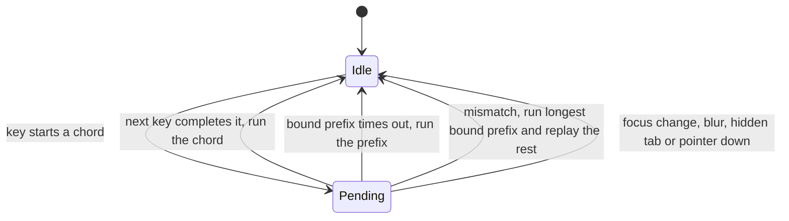

# concepts

the model behind hotkeys: a focus tree, a context stack, a trie of chords, and one ranking rule. read this for the picture, then [keymaps](keymaps.md) for the exact rules

## the short version

<picture>
  <source media="(prefers-color-scheme: dark)" srcset="../../../docs/assets/key-resolution.dark.svg">
  
</picture>

a key press never goes to a global list of shortcuts. it goes to wherever focus is, and the focus decides which bindings are even in play. that is how `Mod+B` can bold text in an editor and toggle a sidebar everywhere else

## the focus tree

a focus node is a place focus can be: a workspace, an editor, a terminal pane. nodes form a tree through `parent`, and each node carries a context and the command handlers that live there

```ts
const hotkeys = createBrowserDispatcher({ keymap })
const workspace = hotkeys.createNode({
  context: 'Workspace',
  commands: { 'sidebar.toggle': toggleSidebar },
})
const editor = hotkeys.createNode({
  parent: workspace,
  context: 'Editor',
  commands: { 'text.bold': bold },
})
```

in the browser you tie nodes to elements with `attachElement(node, element)`. when a key goes down, the closest attached element on the event path picks the node, and the deepest node attached to that element becomes focused. so clicking or tabbing into the editor is what moves focus. outside the browser you call `node.focus()` yourself. removing the focused node, or one it sits inside, moves focus to its nearest live parent

## the context stack

the contexts of the nodes from the outermost to the focused one form the stack. a node with an empty context adds nothing. read it any time with `dispatcher.contextStack()`

a binding's `context` is a predicate over that stack, written in Zed's shorthand: `Workspace > !Terminal`, `Editor && extension == md`. a binding with no `context` matches everywhere

## ranking

when several bindings match a key, the dispatcher picks by deepest matching context, then by source (`user`, then `pack`, then `base`, then `default`), then by table order, with later entries first. the runnable version is in [keymaps](keymaps.md#ranking)

the handler gets the last say. a handler that returns `false` declines: the command goes to the next ancestor, and then the key goes to the next candidate binding. when nothing takes the key, it goes on to the browser's default handling

## chords

strokes separated by spaces, like `Mod+K Mod+C`, are chords. the dispatcher keeps a trie of every bound sequence and holds a pending chord while a longer binding is still reachable



the whole pending chord belongs to the focus it started under, so it cannot leak into a different part of the app. `onPendingChange` tells you when to show a hint, and `onSequence` reports how each chord ended

## layers

hotkeys has three entry points. pick the lowest one you need

| you want                                   | use                         | it adds                                                                        |
| ------------------------------------------ | --------------------------- | ------------------------------------------------------------------------------ |
| `Mod+S` while a view is open               | `getHotkeyRegistry()`       | `register` and `unregister` by key, with the newest registration running first |
| the same key doing different jobs by focus | `createBrowserDispatcher()` | focus nodes, contexts, user overrides, and DOM listeners                       |
| a dispatcher with no DOM                   | `createDispatcher()`        | the same engine fed by your own key events, such as a terminal                 |

the registry sits on a browser dispatcher, so you can start simple and reach the dispatcher later through `registry.dispatcher`

the two layers resolve a shared key differently. in the registry the newest registration for a key runs first, and a callback that returns `false` passes the key on to the next one. it has no notion of focus, so two registrations of `Mod+B` on one target are a conflict, and `conflictBehavior` decides whether that warns, throws, replaces the old one, or is allowed. when the same key should mean different things in different places, use a dispatcher and give each place a context. text inputs are also handled per layer: the registry has `ignoreInputs`, and the dispatcher has contexts, see [troubleshooting](troubleshooting.md#it-works-outside-inputs-but-not-inside)

## where to go next

- [keymaps](keymaps.md) has the predicate syntax, ranking, unbinding, and terminal examples
- [troubleshooting](troubleshooting.md) covers shortcuts that do not fire
- [api](api.md) lists every export
