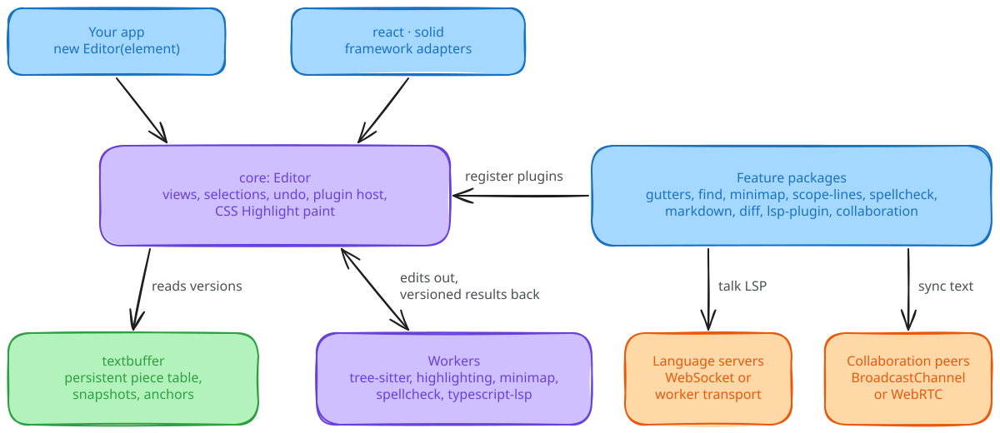

<h1 align="center">Singapore</h1>
<p align="center">A code editor for the browser that keeps every version.</p>
<p align="center">
  <a href="https://github.com/ShaulLavo/fregat/actions/workflows/workspace-libraries.yml"></a>
  <a href="LICENSE"></a>
</p>
<p align="center">
  <a href="https://singapore.shaulavo.dev/">Website and demo</a> ·
  <a href="https://singapore.shaulavo.dev/docs/start-here/introduction/">Docs</a> ·
  <a href="docs/performance/browser-compare-2026-10-08.md">Benchmarks</a> ·
  <a href="https://github.com/ShaulLavo/fregat/discussions">Discussions</a>
</p>

<p align="center"></p>

## Quick start

1. Install the core and a bundler. This example uses Vite.

   ```sh
   npm install @singapore-editor/core vite
   ```

2. Save this as `index.html`. The height and flex column limit the editor's scroll area to the container.

   ```html
   <div id="editor" style="height: 20rem; display: flex; flex-direction: column"></div>
   <script type="module" src="/main.ts"></script>
   ```

3. Save this as `main.ts`.

   ```ts
   import { Editor } from '@singapore-editor/core/editor'
   import '@singapore-editor/core/style.css'

   const element = document.querySelector<HTMLElement>('#editor')!
   const editor = new Editor(element)
   editor.setText('const greeting = "Hello, Singapore"\n')
   // Call editor.dispose() when you remove the editor.
   ```

4. Run `npx vite` and open the printed address. You see one line of text, `const greeting = "Hello, Singapore"`. You can move the caret, select and type.

To run the demo app from source, follow [Development](docs/development.md). The npm packages are older than this source. See [Status](#status).

## Versions and anchors

The editor stores text in `textbuffer`. Every edit returns a new version of the text. Old versions stay readable and share their unchanged storage:

```ts
import {
  createPieceTableSnapshot,
  insertIntoPieceTable,
  materializePieceTableFullText,
} from '@singapore-editor/textbuffer'

const original = createPieceTableSnapshot('hello')
const edited = insertIntoPieceTable(original, 5, ' world')
const branch = insertIntoPieceTable(original, 0, 'say ')

materializePieceTableFullText(original) // 'hello'
materializePieceTableFullText(edited) // 'hello world'
materializePieceTableFullText(branch) // 'say hello'
```

That buffer is the base of a browser editor. You can keep an old snapshot readable while the user edits the current document, and positions called anchors follow the text through every edit.

- **Versions are cheap to keep.** A persistent piece table copies only the tree nodes on the path an edit changes. [Text storage](docs/storage/piece-table.md) explains the tree and snapshots.
- **Positions survive edits.** An anchor points into immutable storage and resolves against any snapshot. Read the [anchor rules](docs/positions/anchors.md).
- **The browser lays out the text.** Singapore mounts the visible rows as DOM and paints syntax colors with the CSS Custom Highlight API. It has no second text-layout engine. [Browser behavior](docs/display/browser-quirks.md) records the engine bugs it works around.
- **Workers do the derived work.** Tree-sitter, the minimap, spellcheck and the TypeScript language service run in workers. The main thread keeps the document.
- **The core stays small.** `new Editor(element)` and `setText(text)` give you an editor. Gutters, search, syntax, language servers and the rest are separate packages.

<picture>
  <source media="(prefers-color-scheme: dark)" srcset="docs/assets/singapore-overview.dark.svg">
  
</picture>

The core reads text from `textbuffer`, sends edits to workers, and gets plugins from the feature packages. Only the feature packages talk to servers and peers.

## Choose packages

Add packages to `core` by what you want to do. Install one with `npm install @singapore-editor/<name>`. Checked with `npm view` on 2026-10-24: packages marked "source only" are not on npm, so build them from source.

- **An editor:** `core` (0.1.2 on npm).
- **Line numbers and fold controls:** `gutters`.
- **Find and replace:** `find`.
- **Syntax colors, folds and brackets:** `tree-sitter` (0.1.1) and `tree-sitter-languages` (0.1.1).
- **Language server diagnostics, completion and hover:** `lsp-plugin`, which brings `lsp` with it.
- **TypeScript and JavaScript intelligence with no server:** `typescript-lsp`.
- **A diff view:** `diff` (0.2.0).
- **Markdown preview:** `markdown`, with `tree-sitter` and `tree-sitter-languages`.
- **React or Solid components:** `react` or `solid`.
- **Several people editing one document:** `collab` and `collaboration`, both source only.
- **A read-only viewer for a very large file:** `paged`, source only.
- **Syntax colors outside an editor, such as code snippets:** `highlighting`, source only. It tokenizes with Shiki and Tree-sitter.
- **Only the persistent text buffer:** `textbuffer` (0.1.0). It does not need `core`.

Three names are easy to mix up:

- **`highlighting` does not add syntax colors to an editor.** For that, use `tree-sitter` with `tree-sitter-languages`, as in the [Languages guide](https://singapore.shaulavo.dev/docs/guides/languages/). `highlighting` is source only, and it depends on `tree-sitter`, `tree-sitter-languages` and `diff`.
- **`collab` and `collaboration` are two layers.** `collab` is the engine: it orders edits and gives each character an identity, with no editor or network. `collaboration` depends on `collab` and adds the editor plugin, session protocol, transports and remote cursors. Neither is on npm.
- **`core/shiki` is not a package.** It is the `@singapore-editor/core/shiki` entry point, which ships in `core`. See [Shiki entry point](packages/editor/README.md#shiki-entry-point).

## Packages

Each package has a short README with install, usage and API notes. The [generated API reference](https://singapore.shaulavo.dev/docs/reference/packages/) covers every export. All packages use the `@singapore-editor/` scope. The folder `packages/editor` publishes as `@singapore-editor/core`.

- **Core:**
  - [`core`](packages/editor/README.md): the editor, with text editing, selections, undo history, themes, and plugins.
  - [`textbuffer`](packages/textbuffer/README.md): persistent piece-table buffer with snapshots, anchors, and line mapping.
- **Syntax:**
  - [`tree-sitter`](packages/tree-sitter/README.md): worker-based parsing for syntax colors, folds, and brackets.
  - [`tree-sitter-languages`](packages/tree-sitter-languages/README.md): grammars and queries for the language plugins.
  - [`highlighting`](packages/highlighting/README.md): worker-based syntax highlighting for editors, diffs, and code snippets.
- **Language servers:**
  - [`lsp`](packages/lsp/README.md): Language Server Protocol client with WebSocket and worker transports.
  - [`lsp-plugin`](packages/lsp-plugin/README.md): diagnostics, completion, hover, and navigation.
  - [`typescript-lsp`](packages/typescript-lsp/README.md): TypeScript and JavaScript language services in a browser worker.
- **Editor features:**
  - [`gutters`](packages/gutters/README.md): line numbers and fold controls.
  - [`find`](packages/find/README.md): find and replace with regular expressions.
  - [`minimap`](packages/minimap/README.md): worker-rendered file overview with scroll controls.
  - [`scope-lines`](packages/scope-lines/README.md): indent guides, sticky headers, and bracket pair colors.
  - [`spellcheck`](packages/spellcheck/README.md): worker-based English spellchecking.
  - [`markdown`](packages/markdown/README.md): Markdown preview and editing commands.
  - [`diff`](packages/diff/README.md): stacked and split diffs with inline changes.
  - [`file-animation`](packages/file-animation/README.md): text reveal animations for opened documents.
  - [`plugin-ui`](packages/plugin-ui/README.md): shared hover tooltips and anchored popups for plugins.
- **Large files:** [`paged`](packages/paged/README.md): read-only UTF-8 viewer model with byte-range loading and a bounded page cache.
- **Collaboration:**
  - [`collab`](packages/collab/README.md): host-ordered editing with persistent snapshots and character identities.
  - [`collaboration`](packages/collaboration/README.md): session protocols, transports, and remote cursor presence.
- **Layout:** [`panes`](packages/panes/README.md): resizable split panes for DOM elements.
- **Frameworks:** [`react`](packages/react/README.md) and [`solid`](packages/solid/README.md): components, hooks, and reactive controls.

Other folders: [`examples/app`](examples/app) is the demo app, [`examples/stress`](examples/stress/README.md) is the stress and latency harness, [`bench/compare`](bench/compare/README.md) runs the browser comparison below, and [`site`](site/README.md) builds the documentation site.

## Guides

- [Mount an editor in React or Solid](https://singapore.shaulavo.dev/docs/guides/frameworks/)
- [Add syntax colors](https://singapore.shaulavo.dev/docs/guides/languages/)
- [Connect a language server](https://singapore.shaulavo.dev/docs/guides/lsp/)
- [Open a very large file](https://singapore.shaulavo.dev/docs/guides/large-files/)
- [Write a plugin](https://singapore.shaulavo.dev/docs/guides/plugins/)
- [Change colors and fonts](https://singapore.shaulavo.dev/docs/guides/themes/)
- [Host the workers in a production build](https://singapore.shaulavo.dev/docs/guides/bundling/)
- Move from [Monaco](https://singapore.shaulavo.dev/docs/start-here/monaco/) or [CodeMirror](https://singapore.shaulavo.dev/docs/start-here/codemirror/)

## How it works

The editor keeps one canonical document on the main thread. An edit makes a new piece-table version, the virtualizer mounts the rows in view, and the browser lays them out. Workers receive source chunks and edits, derive syntax, minimap, spellcheck or language-service state, and send back results tagged with the version they describe, so the editor can recognize a stale answer. [Architecture](ARCHITECTURE.md) has the data flow and the open design questions, and the [ADRs](docs/adr/) record why the shape is this way.

## Docs

- [Documentation site](https://singapore.shaulavo.dev/docs/start-here/introduction/): start here, guides, concepts, and the generated API reference for every package.
- [Architecture](ARCHITECTURE.md) and the [design documents](docs/README.md): storage, positions, editing, display, syntax, workers.
- [ADRs](docs/adr/): four decisions with their alternatives.
- [Known limits](docs/limitations.md): measurement ceilings, analysis budgets and bounded package behavior.
- [Browser quirks](docs/display/browser-quirks.md): engine bugs and their workarounds.
- [Command reference](docs/commands.md): every editor command, generated from the catalog.
- [Development](docs/development.md): build, test and check the packages.

## Performance

One noisy run: a 10 MiB TypeScript document with lexical highlighting, headless Chromium 153 on an Intel Core i7-14700K running Linux, 2026-10-08, other jobs on the host. A quiet rerun is pending. Each measurement lists Singapore, Monaco and CodeMirror in that order.

- First-frame opportunity: 29.6 ms, 89.7 ms, 31.5 ms.
- First detected highlighted text: 1,517.7 ms, 169.4 ms, 56.1 ms. Singapore waits for a full-document parse before it highlights the viewport.
- End typing, p95 frame opportunity: 32.3 ms, 49.0 ms, 32.7 ms.
- JavaScript heap after open: 25.2 MiB, 29.5 MiB, 17.4 MiB.

Singapore passed all three repetitions through 100 MiB and missed the 30-second highlighting deadline on all three attempts at 200 MiB. Its complete TypeScript deployment is 3,074.1 KiB gzip, mostly lazy grammar WebAssembly. Monaco is 775.3 KiB and CodeMirror 161.4 KiB.

The [report](docs/performance/browser-compare-2026-10-08.md) has the method, raw samples, and the commands to rerun it. To check the committed run, from `bench/compare` run `node summarize.mjs ../../docs/performance/browser-compare-2026-10-08/experiment.json.gz`. It prints `45 samples retained; 42 usable`, then the table rows.

## Status

Pre-1.0. The public API is still changing, and source packages are at 0.2.9 (`collab` and `collaboration` at 0.0.4).

- **npm lags the source.** On 2026-10-24, 18 packages were on npm at 0.1.x (`diff` at 0.2.0). `collab`, `collaboration`, `file-animation`, `highlighting` and `paged` were not published, and their READMEs say so. Run `npm view @singapore-editor/<name> version` to check. Package READMEs describe the source, so APIs they show can be newer than the npm release. Publishing the current release is deferred.
- **Browsers.** Input goes through a textarea by default. Pass `inputRoute: 'edit-context'` to use EditContext in engines that have it, which today means Chromium. The Vitest browser projects in `packages/editor` run the full browser suite in Chromium, and the scroll, layout and paint suites in Firefox and WebKit too. Tree-sitter syntax needs Chromium 144, Firefox 145, Safari 26.2 or newer, because the parser uses `WebAssembly.Memory.prototype.toResizableBuffer()` ([tree-sitter README](packages/tree-sitter/README.md)). [Browser quirks](docs/display/browser-quirks.md) lists the known engine bugs.
- **Accessibility.** The docs site says screen-reader support has no published audit.
- **Touch and mobile.** Mobile is not a supported target. The source has experimental touch selection: hold or double-tap a word and drag, triple-tap a line, four taps for the document, with an opt-in menu plugin. Neither the gestures nor the menu are in the npm packages. The tests for them use emulated iPhone 13 profiles in Chromium and WebKit and an iOS simulator, not real devices. See [Touch selection](packages/editor/README.md#touch-selection).
- **Layout.** Text rows have a fixed height today. `::highlight()` cannot set font weight or font style, so syntax colors cannot be bold or italic.
- **Workers.** Tree-sitter needs your build to serve the worker and its WebAssembly file. See [Bundling and workers](https://singapore.shaulavo.dev/docs/guides/bundling/).

### What differs between npm 0.1.x and the source

The package changelogs start at 0.2.1, so no changelog covers 0.1.x. Comparing the published `@singapore-editor/core@0.1.2` and `@singapore-editor/plugin-ui@0.1.0` tarballs with the source shows these differences:

- `core` 0.1.2 has no `./paint` or `./internal/document-worker` entry point, and its scroll modes are `'virtualized'` and `'static'` only. The source also has `scrollMode: 'content'`, which throws `EDITOR_CONTENT_LAYOUT_LIMIT` when the layout limits are exceeded, and `captureSnapshot({ scope: 'document' })`.
- Neither tarball contains the touch selection controller, `createTouchSelectionPlugin` or the touch menu.
- `collab`, `collaboration`, `file-animation`, `highlighting` and `paged` have no published version at all.

Other changes are listed in each package's `CHANGELOG.md` from 0.2.1 on. Everything the package READMEs show was written against the source. An example can fail against 0.1.x, so check an API in the published package before you rely on it.

The [known limits page](docs/limitations.md) lists exact ceilings, such as the 32,000-code-unit row length at which right-to-left rows stop measuring.

## Credits and contributing

Singapore borrows ideas from [CodeMirror](https://codemirror.net/), [Monaco and VS Code](https://github.com/microsoft/monaco-editor), [Fred](https://github.com/cdacamar/fredbuf), Cameron DaCamara's editor, and [Zed](https://zed.dev/).

Development happens in [Fregat](https://github.com/ShaulLavo/fregat/tree/main/packages/singapore). This repository is a read-only mirror of its `packages/singapore/` folder, so open issues and pull requests in Fregat. Read the [contribution guide and AI policy](https://github.com/ShaulLavo/fregat/blob/main/CONTRIBUTING.md) first. Report security problems through the [security policy](https://github.com/ShaulLavo/fregat/blob/main/SECURITY.md).

## License

[MIT](LICENSE). Dependencies keep their own licenses.
